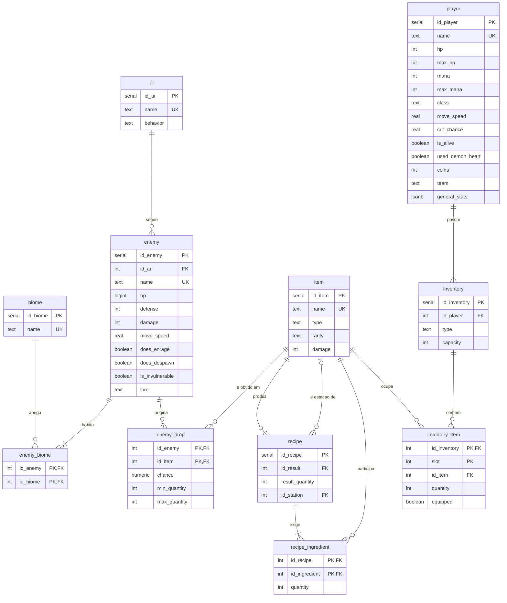

# DER — Segunda iteração

Diagrama em notação pé-de-galinha (crow's foot). As tabelas e colunas estão exatamente como em `sql/01_schema.sql`. As mudanças em relação à primeira iteração estão em [`docs/mudancas.md`](../mudancas.md).

## Cardinalidades

| Relacionamento | Cardinalidade | Significado |
|---|---|---|
| player — inventory | `1 : 1..*` | Um jogador possui um ou mais inventários (no máximo um de cada tipo). |
| inventory — inventory_item | `1 : 0..*` | Um inventário pode ter vários slots ocupados. |
| item — inventory_item | `1 : 0..*` | Um item pode aparecer em vários slots e inventários. |
| enemy — biome (via enemy_biome) | `N : M` | Um inimigo habita um ou mais biomas; um bioma abriga zero ou mais inimigos. |
| ai — enemy | `1 : 0..*` | Um padrão de IA pode ser usado por vários inimigos. |
| enemy — enemy_drop | `1 : 0..*` | Um inimigo pode ter vários drops. |
| item — enemy_drop | `1 : 0..*` | Um item pode ser dropado por vários inimigos. |
| item — recipe (resultado) | `1 : 0..*` | Um item pode ter várias receitas alternativas. |
| item — recipe (estação) | `0..1 : 0..*` | Uma receita exige no máximo uma estação, que também é um item; sem estação, é feita à mão. |
| recipe — recipe_ingredient | `1 : 1..*` | Uma receita exige pelo menos um ingrediente. |
| item — recipe_ingredient | `1 : 0..*` | Um item pode ser ingrediente de várias receitas. |
