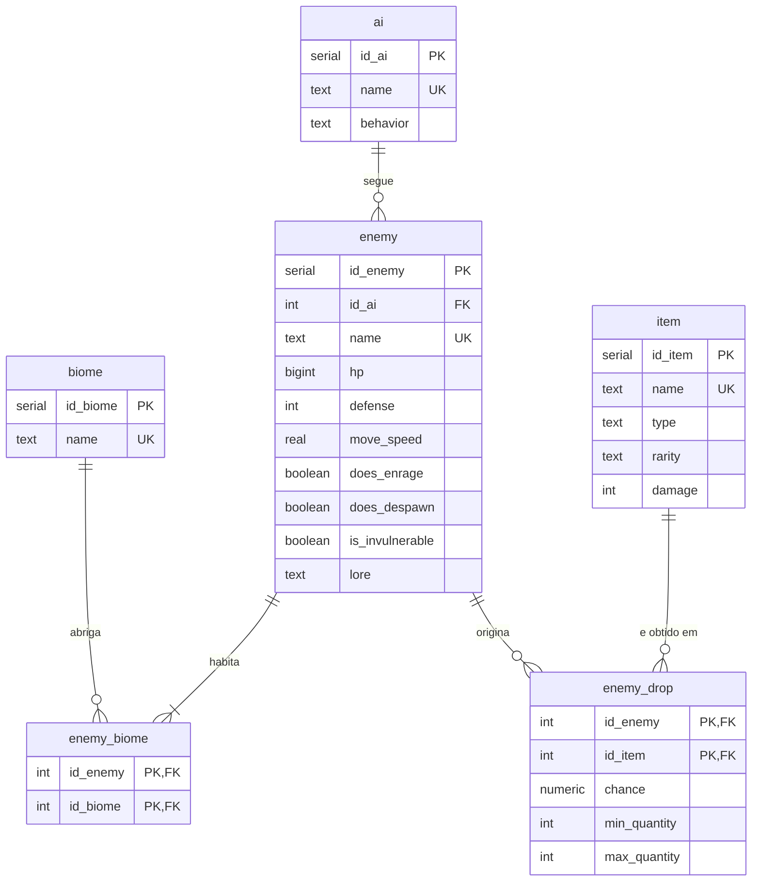

# DER — Segunda iteração

Diagrama em notação pé-de-galinha (crow's foot). As tabelas e colunas estão exatamente como em `sql/01_schema.sql`. As mudanças em relação à primeira iteração estão em [`docs/mudancas.md`](../mudancas.md).

